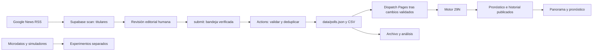

# Auditoría funcional y mejoras del Observatorio · 11 de noviembre de 2026

Rama: `codex/auditoria-actualizador-interiores`. Base examinada: `4495141ae2db0d81fc0de7a943db159be283763b`.

## Alcance y estado de aceptación

Esta intervención repara defectos comprobables del circuito, introduce una arquitectura de acceso común a las siete secciones y añade dos visualizaciones sobre datos existentes. Conserva las páginas y módulos especializados; **no constituye todavía el rediseño profundo de cada herramienta secundaria**. El inventario adjunto permite continuar por secciones sin perder contenidos ni dependencias.

No se ha desplegado Supabase, publicado Pages ni fusionado en main. El 502 de producción continúa pendiente de validar tras un despliegue autorizado. No se ha incorporado ninguna encuesta real para probar el circuito: se han usado fichas sintéticas en pruebas aisladas.

## Diagnóstico del actualizador

Evidencia tomada el 11 de noviembre:

- `status`: HTTP 200, última búsqueda válida `2026-11-10T15:45:37.173Z`, con errores de las cinco consultas del día 11.
- `approved`: HTTP 200, bandeja vacía.
- `scan`: HTTP 502 a las `10:32:27Z` (11:32 en Madrid), conserva los candidatos anteriores. Supabase registra 8248 ms para esta petición. Los registros de las 09:20 UTC muestran también 502 en otra región.
- Función desplegada `encuestas`, versión 4: coincide con la implementación base. El `catch` de cada RSS descarta la excepción; los registros de función solo contienen arranques y apagados. **No existe evidencia suficiente para distinguir HTTP remoto, red, TLS o timeout como causa raíz.** No se atribuye a Google ni se da por reparada la conectividad de Supabase.
- Las cinco consultas idénticas funcionan desde el entorno de trabajo con el módulo nuevo: 80 titulares únicos, 0 errores, a las `10:33:44Z`. Esta comprobación no reproduce la red de salida de Supabase.
- GitHub Actions: ejecución `42847668130` del 10 de noviembre, trabajo `129939434833`, completada correctamente. No consta una ejecución del día 11 en la consulta realizada. No se ha lanzado una tarea de producción.

Cambios:

1. Módulo RSS aislado y comprobable: diagnóstico de cada fuente, tiempo limitado que incluye lectura del cuerpo, límite de 2 MB durante la lectura, un reintento de errores transitorios (red, timeout, 408 y 5xx), sin reintentar rechazos permanentes. Conserva la última búsqueda válida cuando todas fallan; libera el bloqueo para reintentar.
2. Un resultado vacío válido se diferencia de HTML, RSS truncado y fallo total. Una respuesta parcial conserva los candidatos válidos y muestra las fuentes fallidas. No afirma incorporación ni recálculo por detectar titulares.
3. Se conserva el contrato de base de datos: no hay migración, nuevas tablas, permisos ni cambios de RLS. `status`, `approved` y `submit` mantienen sus formatos. `scan` añade `sources` y `partial` en su respuesta.
4. La recarga del archivo propaga los nuevos registros al panorama, archivo filtrable, promedio y tabla del corte. El Motor 29N sigue leyendo exclusivamente su salida publicada.
5. La vigilancia usaba un push con `GITHUB_TOKEN` como supuesto disparador de Pages. Estos pushes no disparan otro workflow `push`. Ahora solicita explícitamente `pages.yml` después de un push correcto y solo cuando cambió `polls.json` y pasaron las pruebas. La vigilancia queda restringida a main; los cambios de estado o CSV no solicitan recálculo. Los artefactos se suben al final para incluir el informe de incorporación.
6. El circuito visual separa Buscar → Detectar → Verificar → Incorporar → Recalcular → Publicar, con resultado y fecha cuando existen. «Sin registro» no equivale a fallo ni a éxito. La fecha de construcción no acredita por sí sola la incorporación de una encuesta; se conserva el corte del modelo.

Riesgo operativo pendiente: probar el dispatch de Pages en GitHub tras integrar y con una ficha real autorizada; un despacho aceptado tampoco prueba que el despliegue final haya concluido. `ultimo_recalculo_lanzado` no se rellena artificialmente: se muestra como desconocido cuando no hay registro.

## Inventario y decisiones de presentación

El [inventario completo](inventario-observatorio.json) enumera páginas, módulos, enlaces, anclas, archivos de datos literales y consumidores. Se regenera con `python scripts/inventario_observatorio.py`. No resuelve expresiones dinámicas; se complementa con las pruebas de rutas y de navegador.

| Sección | Finalidad y bloques conservados | Entradas / consumidores | Decisión aplicada y continuación |
|---|---|---|---|
| Panorama | Referencia, bloques, evolución, capas, accesos | `home-impact`, `portada-hub`, `portada-series`, `capas`; pronóstico, historial, encuestas, acontecimientos | Referencia visual conservada; se refresca con el archivo. No modifica las cifras publicadas. |
| Pronóstico | Intervalos, variantes, cocina, bloques, investidura, evolución, territorio, fuentes, evaluación, externos, cambios y procedencia | `pronostico-vista`, `pronostico-orden`, `trazabilidad`, `investidura`, `dashboard-validacion`, `contraste-capas`; JSON del modelo e historial | Acceso inmediato por pregunta y nivel de profundidad; todos los apartados existentes se conservan. No se duplica el cálculo de intervalos. |
| Encuestas | Archivo histórico, corte usado/excluido, fichas, fuentes externas, comparación de casas, promedio editable y actualización | `polls`, `analysis`, `promedios-comparador`, `encuestas-servicio`; `polls.json`, referencias, entradas del modelo | Gráfico de puntos ligado a todos los filtros y candidatura con etiqueta original. La tabla del corte se pliega para evitar que domine la entrada; la tabla del archivo permite inspeccionar cada punto y ficha. Son universos distintos, no se fusionan ni se suman. |
| Cocina | Conceptos, caso completo, evidencia de casas, contraste de recetas, cocina aplicada y archivo de microdatos | `cocina`, `casos-cocina`, módulos `cocina-*`, `catalogo-microdatos`, `auditoria-microdatos`; agregados documentados | Guía de tres accesos; conserva los seis capítulos y sus módulos. Próxima revisión: simplificar controles por capítulo con pruebas específicas, sin colapsar sus distintos denominadores. |
| Acontecimientos | Selección de suceso, ventana, lectura visual, series por casa, campos y método | `events`, `acontecimiento`, `eventos-visual`; `events.json`, encuestas, modelo y elección | Accesos a controles, resultados y límites. Se mantienen ventanas y avisos de comparabilidad; ningún nuevo coeficiente causal. |
| Método | Herramientas, algoritmo, fuentes, D’Hondt, microdatos, mantenimiento y documentación | `app`, flujograma y documentos originales | Guía común y acceso directo a fuentes. Se mantiene el directorio completo y el archivo de versiones anteriores. |
| Atlas | Mapa/índice, búsqueda y orden territorial, participación, voto, escaños y CSV | `map`, `app`; `election.json`, `cartography.json`, fuentes JEC/BOE | Accesos a selección, detalle y simulación; rutas compatibles. Mapa conservado como índice territorial, sin fingir coordenadas geográficas. |
| Laboratorio | Multiplicadores, territorio, umbral, blanco, semilla, resultado, exportación y cocientes | `engine`, `app`; elección 2023 | Barras divergentes con eje cero y escala simétrica para cambios de escaños. La tabla completa permanece. No se transfiere el escenario al pronóstico. |

### Páginas secundarias y documentación

Se conservan `flujograma.html`, `pronostico.html` (generada desde `modelo/pagina/plantilla.html`), `como-estimamos.html`, `metodo-evidencia.html`, `metodologia-analisis.html`, `construye-estimacion.html`, `tutorial-estimacion.html`, `guia-cocina.html`, `diagnostico-cis.html`, `laboratorio-imputaciones.html`, `validacion-recetas.html` y `sala-mandos.html`. El inventario identifica sus enlaces y módulos. No se han retirado los documentos `docs/`, los datos de `data/`, las fuentes originales ni los ejercicios de validación 2019/2023.

La repetición explicativa de las cuatro capas pasa a una clave común plegable que reutiliza `LAYERS` en vez de definir otro contrato. Los textos específicos, hipótesis y advertencias por ejercicio permanecen donde se interpretan las cifras. La tabla del último corte incluye entradas del modelo que pueden faltar en el archivo editorial: se presenta como auditoría, no como una segunda lista equivalente.

## Dependencias y protección del modelo

El RSS no escribe porcentajes. La edición no modifica directamente `polls.json`. La deduplicación y las correcciones de fichas publicadas mantienen su revisión editorial. Las entradas, código estadístico, historial y salidas del modelo no se han modificado. Se comprueban por igualdad de archivos con la base, además de las pruebas del motor; no se ha recalculado un pronóstico distinto por razones visuales.

## Validación y pendientes

Los resultados finales de pruebas y comprobaciones de navegador se registran en la descripción del PR. Se verifican navegación principal a 390/768/1440 px, filtros sincronizados, ausencia frente a cero, signos de diferencias, endpoints simulados, búsqueda parcial/total, guardado y deduplicación, incorporación editorial y tests del motor. La inspección automatizada de accesibilidad no sustituye a una revisión manual con lector de pantalla.

Pendiente para aceptación completa: desplegar y comprobar Supabase tras autorización; probar incorporación y publicación real sin inventar sondeos; rediseñar en detalle las herramientas secundarias; ampliar la revisión manual de accesibilidad y cobertura de enlaces externos. No se afirma una reparación completa de producción ni una renovación integral terminada.

### Resultados de esta rama

- `npm test`: **326/326** pruebas JavaScript correctas (315 en la base; 11 nuevas).
- Python scripts: **45/45**; modelo: **54/54**. Se observaron avisos previos `ResourceWarning` por archivos de pruebas sin cerrar, sin fallos.
- `npm run build`: correcto, 19 estudios del archivo, 11 institutos, 8 referencias y 8 acontecimientos.
- `npm run test:browser`: **24** combinaciones de ocho rutas y tres tamaños (390/768/1440); siete secciones revisadas con axe WCAG A/AA, **0 infracciones detectadas** después de reparar cuatro incidencias encontradas. Pruebas de filtros, ceros/ausencias, acceso a fichas con teclado, recarga interceptada y cambio de escaños correctas.
- 152 enlaces/recursos locales de los HTML construidos: ninguno ausente. No equivale a validar todos los enlaces externos ni todos los destinos dinámicos.
- `git diff --check`: correcto. Igualdad completa con la base en `modelo/`, `data/`, `engine.mjs` y `capas.mjs`.
- SHA-256 de `modelo/salida/pronostico.json`: `d41bf2822185f5d2232d2f8719d4c9e8a974e81cb47771fc236adc4c9134be10`.
- Se conserva la configuración de veda; el comprobador de navegador valida el artefacto restringido si se ejecuta durante ella.

Para repetir la revisión de navegador: `npm ci`, `npx playwright install chromium`, `npm run build`; iniciar `npm run dev` en otra terminal y ejecutar `npm run test:browser`. `CHROMIUM_PATH` permite usar un Chromium instalado y `BROWSER_URL` cambiar la URL local. Capturas e informe JSON: `work/auditoria-interiores/`. La revisión rápida del PR ejecuta estas comprobaciones y conserva sus artefactos sin publicar producción.
