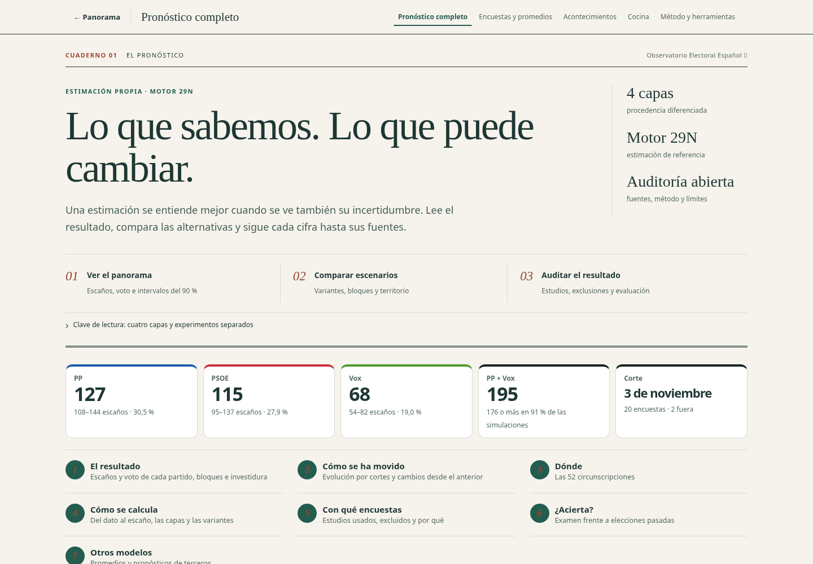
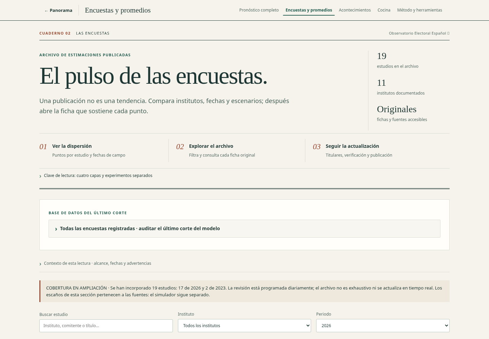
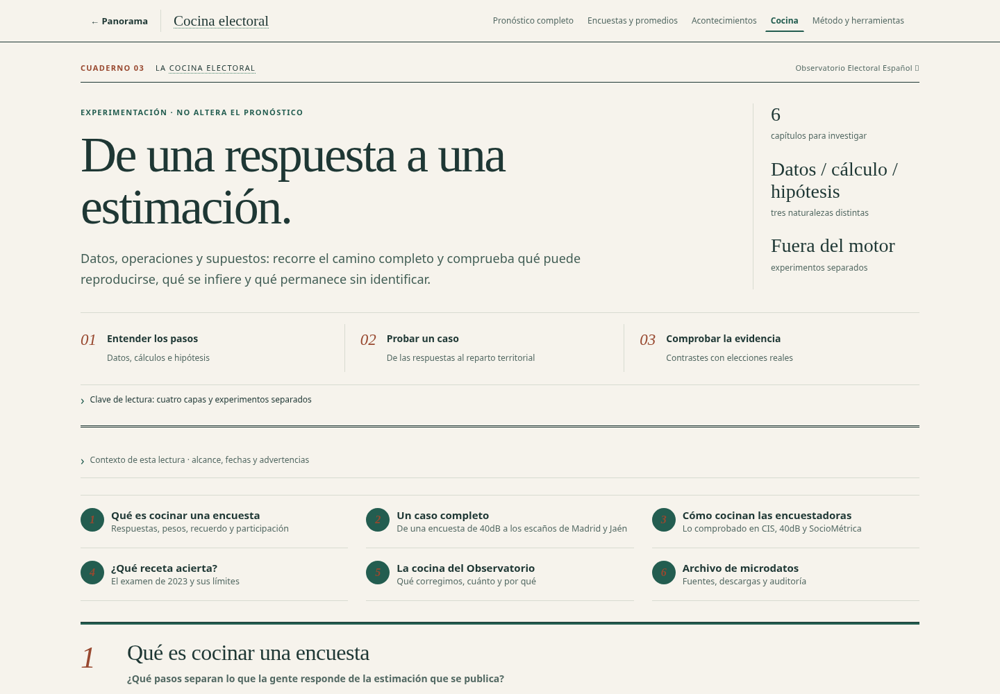
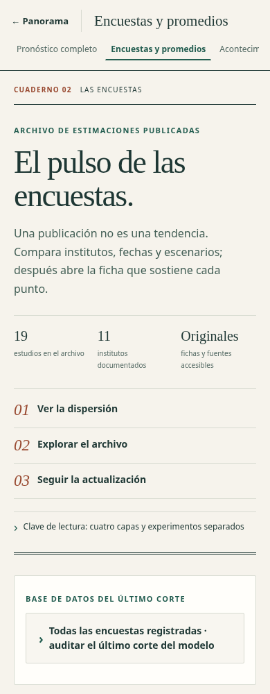

# Transformación editorial y retirada del backend anterior

11 de noviembre de 2026 · rama `codex/transformacion-editorial-sin-supabase`.

## Lectura y exploración

La portada y las siete secciones comparten ahora un lenguaje editorial: tipografía de lectura, fondo papel, jerarquía de titulares y navegación por preguntas. Las cifras y colores de partidos mantienen su significado. La transformación no introduce estimaciones ni modifica el Motor 29N.

El pronóstico abre con cifras clave y el capítulo del resultado. Los otros seis capítulos siguen disponibles mediante navegación directa y bloques desplegables. La cocina conserva sus seis capítulos, ahora con lectura progresiva; un enlace a cualquier capítulo abre automáticamente el bloque correspondiente. Las cabeceras originales, fechas y advertencias se conservan en «Contexto de esta lectura», sin duplicar dos introducciones extensas. Las páginas independientes de método y herramientas comparten la misma identidad y mantienen sus cálculos e interacciones.

| Pronóstico | Encuestas |
|---|---|
|  |  |

| Cocina | Móvil |
|---|---|
|  |  |

Capturas de revisión local: cada cifra conserva el corte de la salida versionada usada para la captura. La publicación ejecuta el recálculo habitual antes de desplegar.

## Nuevo sistema documental

La vigilancia consulta directamente seis índices: tres RSS de medios (EL PAÍS, EL MUNDO y EL ESPAÑOL) y tres productores (CIS, GAD3 y More in Common). El fichero de configuración está en `data/vigilancia/fuentes.json`.

- El primer informe comprobado tuvo **5 de 6 fuentes accesibles y 15 candidatos**. GAD3 devolvió un desafío HTTP 202, registrado como incidencia en vez de fingir una consulta vacía correcta.
- La búsqueda documental de microdatos consultó **9 páginas y pudo leer 8**, sin descargar ni incorporar matrices.
- GitHub Actions ejecuta la vigilancia cuatro veces al día y admite ejecución manual. El informe queda versionado; «Consultar novedades» recupera el último informe, no anuncia una búsqueda nueva ni pide claves.
- La bandeja editorial es `data/ingesta/validadas.json`. La migración conserva `data/ingesta/bandeja-migrada.json`; la comprobación del servicio anterior no encontró fichas pendientes.
- Solo se incorporan fichas contrastadas y deduplicadas. Solo un cambio efectivo de `polls.json` solicita el recálculo y Pages desde la vigilancia. Se han eliminado los comentarios automáticos duplicados en Issues.
- El cliente y los workflows activos no usan Supabase. Su código y documentación anterior se conservan en `docs/archivo-tecnico/` como archivo, sin ejecutarlo en la aplicación.

Un fallo total conserva candidatos y fecha anteriores; un fallo parcial mantiene la cobertura accesible y comunica la incidencia. Ningún titular se trata como una encuesta verificada ni se utiliza como porcentaje electoral.

## Custodia privada migrada

El propietario creó `bhermoso/observatorio-electoral-custodia`. Se comprobó en GitHub que es **privado** y accesible para la conexión autorizada. Los cuatro ZIP de More in Common se guardaron allí y se recuperaron mediante un segundo clon independiente. Todos coincidieron en tamaño y SHA-256 con las huellas del depósito anterior.

Commit del depósito: `a55d55eeed1d004c6c04fd5fbde8ad954b7aee14`. El workflow privado de integridad pasó. Los originales y sus matrices **no se han añadido al repositorio público**. El certificado público `data/microdatos/custodia.json` contiene solo metadatos, commit y fecha de recuperación. La propia conexión tiene acceso al repositorio privado; sus peticiones no sirven para demostrar lo que puede leer un visitante anónimo.

La migración no amplía los permisos de uso ni convierte estos estudios en encuestas admitidas por el modelo. No se elimina el depósito anterior ni el proyecto remoto antes de completar el cambio de la web publicada; los datos originales quedan conservados.

## Pruebas

- 324 pruebas JavaScript, 46 Python de scripts y 54 del modelo correctas en local.
- Navegador: 24 combinaciones de ocho rutas y tres tamaños; 24 combinaciones de doce documentos independientes y dos tamaños. Sin desbordamiento de página ni errores JavaScript en las pantallas revisadas.
- Siete secciones con axe WCAG A/AA: cero infracciones detectadas tras ajustar el contraste editorial.
- Filtros, teclado, acceso a fichas, recarga, mensajes de búsqueda fallida, apertura de capítulos y visibilidad del pronóstico principal comprobados.
- Comprobación automática de que el grafo de módulos del cliente y los workflows no llaman al backend retirado. Las pruebas históricas de las funciones archivadas usan respuestas simuladas.
- Igualdad con la base en `modelo/`, `data/polls.json`, `data/election.json`, `engine.mjs` y `capas.mjs`.
- El PR añade pruebas de acceso a las fuentes desde GitHub Actions, sin incorporar sondeos ni publicar producción durante la comprobación.

La disponibilidad de cada productor puede variar. Una cobertura parcial queda visible y no se convierte en «sin novedades». La inspección automatizada de accesibilidad no sustituye a una revisión completa con lector de pantalla.
